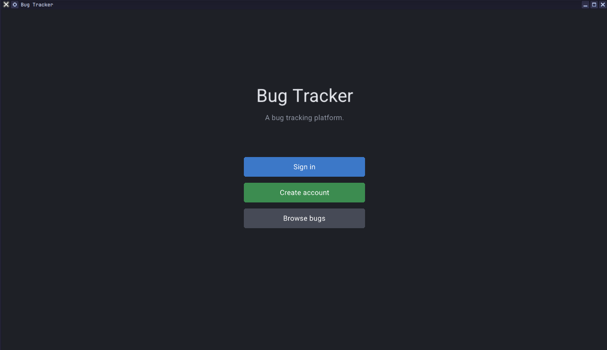
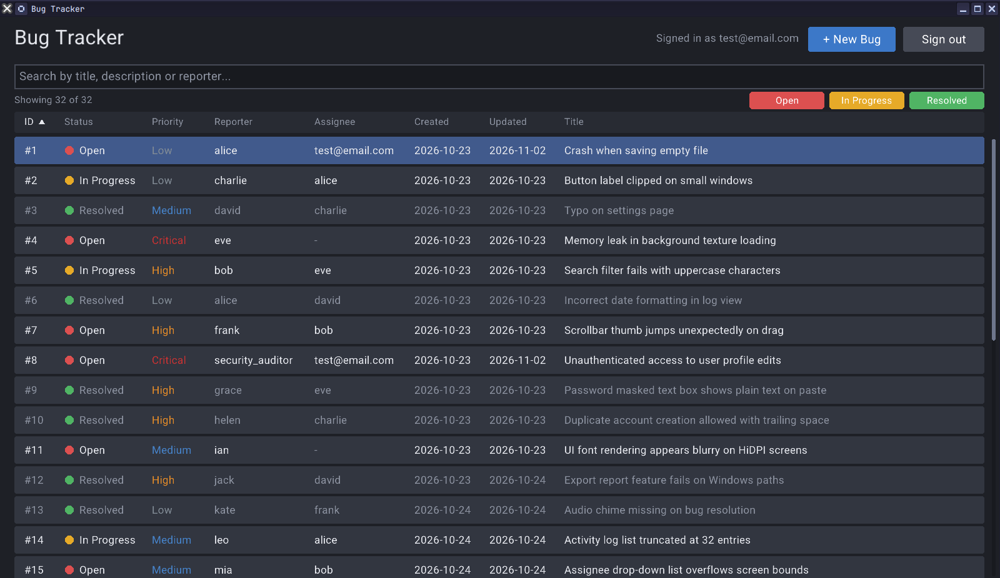
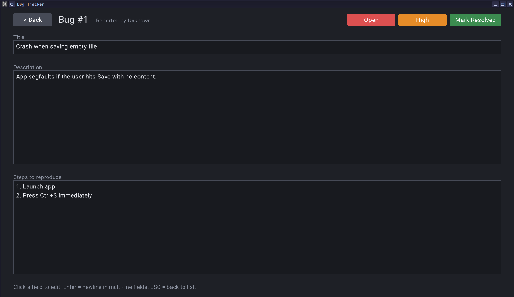

## Bug Tracking Platform

### Description

A lightweight desktop bug tracker written in C with [raylib](https://www.raylib.com/), inspired by Bugzilla. A developer can quickly record, find, update and resolve bugs, with accounts, a searchable and sortable bug list, and a detail page for each bug.

This is a learning project, built incrementally in small vertical slices with an AI assistant used as a development aid. It is a prototype, not a replacement for a mature bug tracker (see [Limitations](#limitations)).

### Features

- **Welcome page** shown on every launch: sign in, create an account, or browse
- **Accounts:** create an account and sign in; guests can browse and read bugs but must sign in to create or edit them
- **Bug list as a table:** ID, status, priority, reporter and title
- **Sorting:** click a column header to sort by it, click again to reverse
- **Live search** across title, description and reporter (case-insensitive)
- **Status filter chips** (Open, In Progress, Resolved), combinable with search, plus a "Showing N of M" count
- **Scrolling** with the mouse wheel and a draggable scrollbar
- **Create a bug** (records who reported it) and **edit** its title, description and steps to reproduce
- **Change status** (Open, In Progress, Resolved) and **priority** (Low, Medium, High, Critical), with a "Mark Resolved" shortcut
- Resolved bugs stay in the list, dimmed, so they can still be found
- **Automatic saving** of bugs and accounts

### Controls

Mouse:
- Click buttons, chips, text fields and table rows
- Click a column header to sort; click it again to reverse the order
- Mouse wheel over the table to scroll; drag the scrollbar thumb
- Click the **Bug Tracker** title on the Browse page to return to the welcome page

Keyboard:
- Type to edit the focused field; **Backspace** deletes
- **Enter** adds a new line in the description and steps fields, and submits the sign-in / create-account form
- **Tab** moves to the next field on the sign-in / create-account form
- **Esc** goes back from the detail page and from the sign-in page

### Screenshots

**Home page**

**Browse bugs** (search, status filter chips and sortable columns)

**Add a bug**

### Developers

- Damon Kelly - list scrolling, search, status filter, project setup and add page
- Andrii Shyiko - welcome page, accounts and sign-in, Browse table and sorting, detail page and fonts

### License

This project sources are licensed under an unmodified zlib/libpng license, which is an OSI-certified, BSD-like license that allows static linking with closed source software. Check [LICENSE](LICENSE) for further details.

Additional licenses:
- [raylib](https://www.raylib.com/) (zlib license), downloaded automatically at build time
- [Roboto](https://fonts.google.com/specimen/Roboto) font by Google (Apache License 2.0)
- Started from the [raylib game template](https://github.com/raysan5/raylib-game-template)

## Build

Requirements: a C compiler, CMake 3.24 or newer, and an internet connection on the first build (CMake downloads and builds raylib 6.0). On Linux you also need the X11 and OpenGL development packages raylib uses. Developed and tested on Linux (Fedora); other platforms are untested.

    cmake -B build
    cmake --build build -j$(nproc)
    ./build/bugtracker/bugtracker

The first launch loads three example bugs. Create an account on the welcome page to start adding your own.

`bugs.dat` and `users.txt` are stored next to the executable, in `build/bugtracker/`. **Deleting the `build` folder deletes all bugs and accounts**, so copy those two files somewhere safe first if you want to keep them.

### Limitations

- **Not secure:** passwords are stored in plain text in `users.txt`. Do not reuse a real password.
- **Local only:** no networking or shared database, and no roles or permissions. Every signed-in user can edit every bug.
- **Basic text editing:** typing at the end of a field and backspace only (no cursor movement or selection), ASCII characters only, no word wrap.
- **Fixed sizes:** up to 128 bugs and 32 accounts; title 63 characters, description and steps 511 characters each.
- **No delete:** bugs can be resolved but not removed.
- **Save format:** bugs are saved as a raw binary dump of the C structs, so the file is not portable between machines or compilers.
- **No history yet:** a bug records its reporter, but not when it changed or who changed it.

### Roadmap

1. Created and last-updated dates on every bug
2. Comments and an activity log on each bug
3. A fuller bug lifecycle: a Closed status, required resolutions (Fixed, Won't Fix, Duplicate...) and an assignee
4. A report-a-bug screen with a draft and validation
5. Splitting `main.c` into separate files